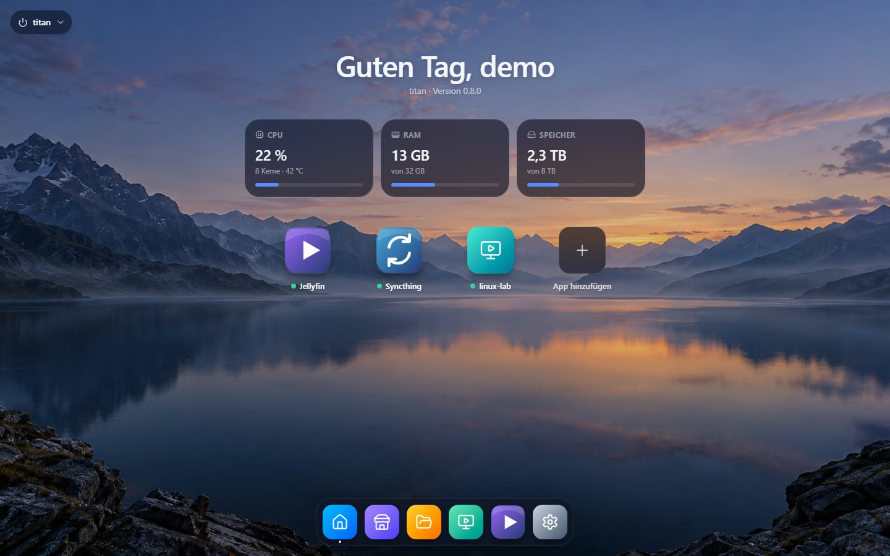
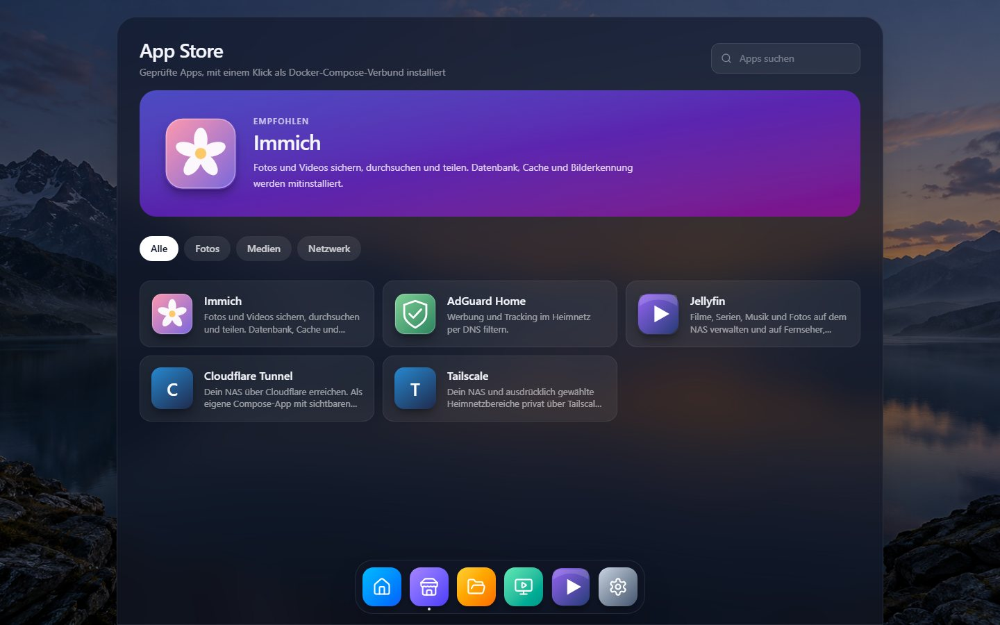
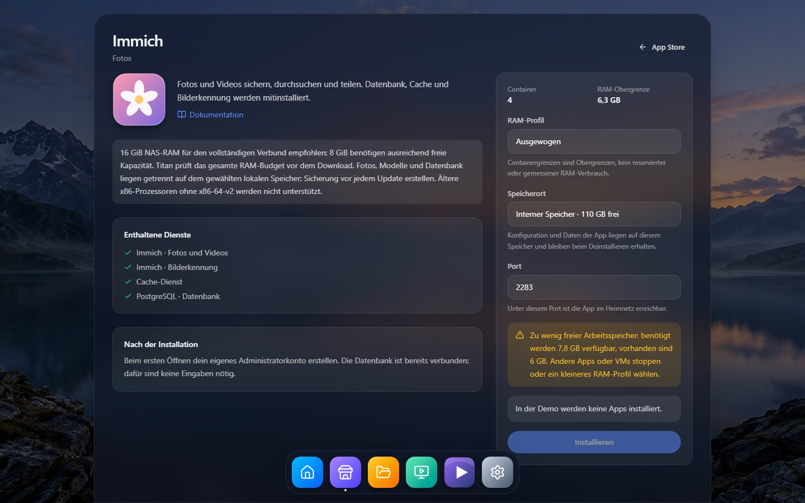
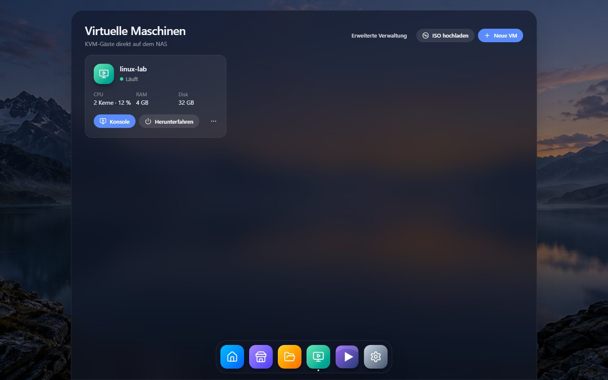
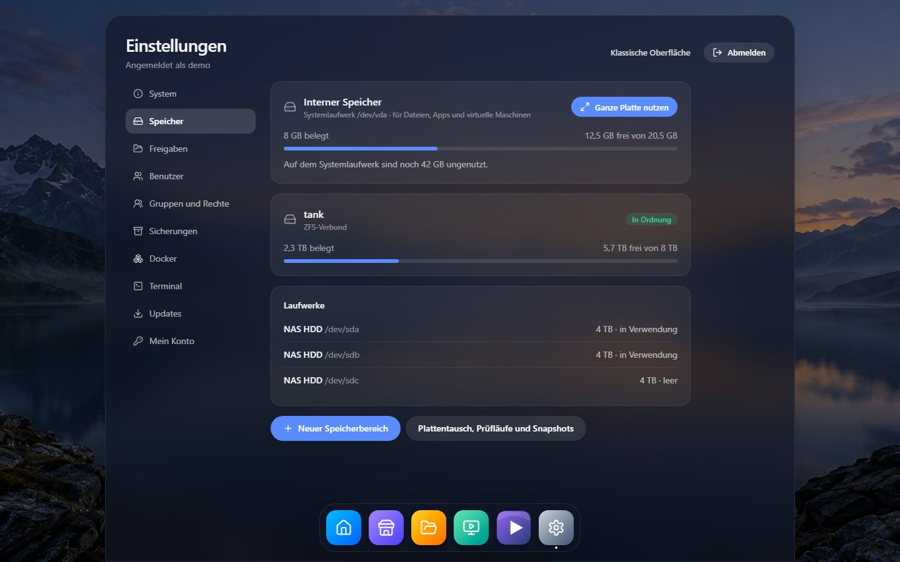
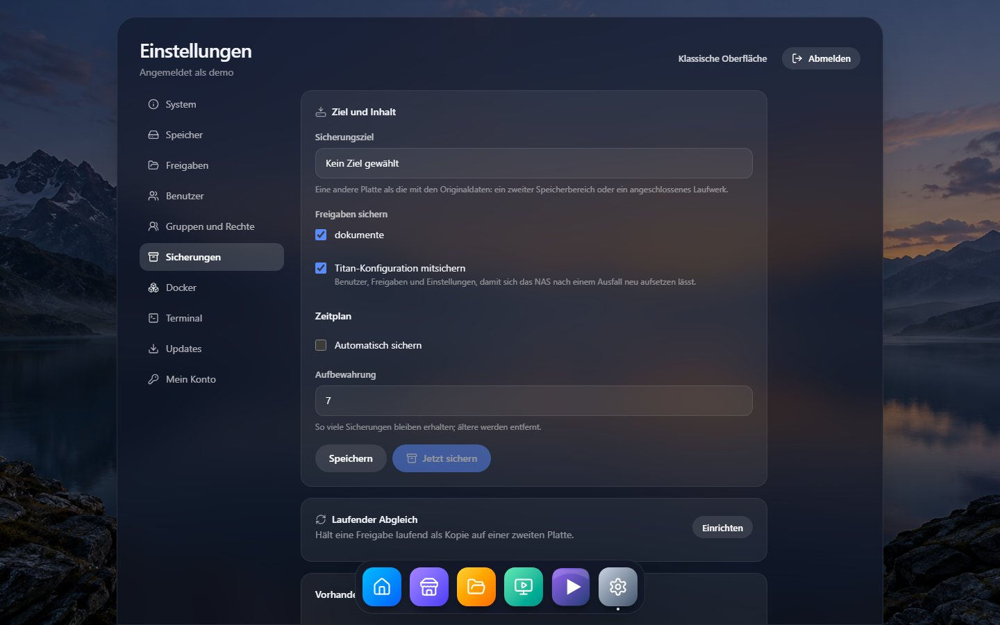
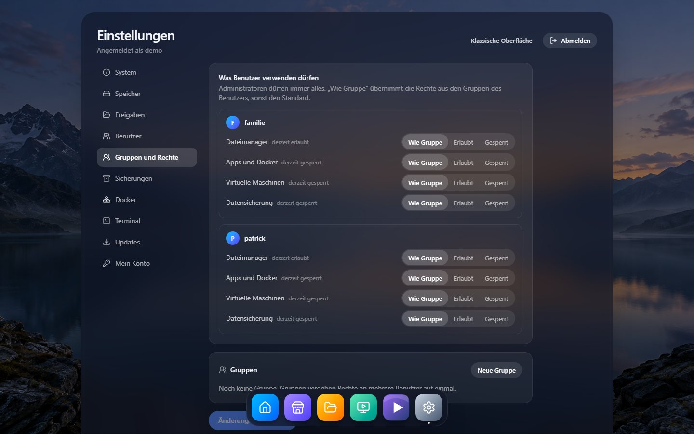
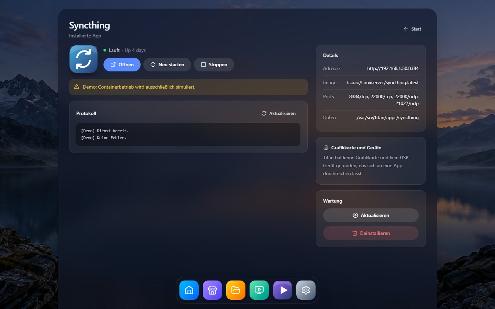
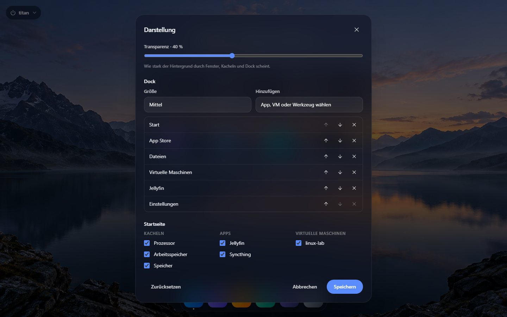

<div align="center">

# TITAN

### Dein Server. Deine Daten. Eine Oberfläche.

Titan macht aus einem PC oder Mini-Server ein NAS mit Apps, virtuellen Maschinen und Sicherungen,
bedient komplett im Browser.

[](https://github.com/ra5on/Titan/releases)
[](docs/INSTALL.md)
[](#lizenz)

[**Image herunterladen**](https://github.com/ra5on/Titan/releases) · [Installation](docs/INSTALL.md) · [Was ist neu in 0.8.0](docs/RELEASE-0.8.0.md)



</div>

## Was Titan kann

| | |
| --- | --- |
| **📦 Apps mit einem Klick** | Immich, Jellyfin, AdGuard Home, Tailscale und Cloudflare Tunnel aus dem eigenen App Store. Titan prüft vorher, ob der Arbeitsspeicher reicht, und zeigt jeden Installationsschritt. |
| **🗂️ Dateien und Freigaben** | Dateimanager im Browser, Netzwerkfreigaben mit Rechten pro Benutzer, Papierkorb, Upload mit Fortschritt. Ein angestecktes USB-Laufwerk erscheint von selbst. |
| **🖥️ Virtuelle Maschinen** | VMs aus ISO oder vorhandener QCOW2-Festplatte, Konsole direkt im Browser, USB-Geräte und ganze Grafikkarten durchreichen. |
| **💾 Speicher** | Die ganze Installationsplatte nutzen, weitere Laufwerke als Ext4, XFS oder Btrfs einrichten oder mehrere zu einem ausfallsicheren ZFS-Verbund zusammenfassen. |
| **🛟 Sicherung und Abgleich** | Sicherungen auf eine andere Platte nach Zeitplan, mit Prüfung und Wiederherstellung. Dazu ein laufender Abgleich einer Freigabe auf ein zweites Laufwerk. |
| **🎛️ Hardware für Apps** | Grafikkarte, KI-Beschleuniger und USB-Geräte pro App auswählen, zum Beispiel für Transkodierung oder einen Zigbee-Stick. |
| **👥 Benutzer und Rechte** | Konten, Gruppen, Zwei-Faktor-Anmeldung und genau einstellbar, wer Dateien, Apps, VMs und Sicherungen verwenden darf. |
| **🔄 Sichere Updates** | Signierte Systemupdates in einen zweiten Systembereich. Startet ein Update nicht, kehrt Titan automatisch zum vorherigen Stand zurück. |

## Ein Blick hinein

<table>
<tr>
<td width="50%"><br><sub><b>App Store</b> · Apps suchen, ansehen, installieren</sub></td>
<td width="50%"><br><sub><b>Installation</b> · Speicherort, Port und RAM-Prüfung vorab</sub></td>
</tr>
<tr>
<td><br><sub><b>Virtuelle Maschinen</b> · Konsole, USB und Grafikkarte</sub></td>
<td><br><sub><b>Speicher</b> · Laufwerke einrichten und überblicken</sub></td>
</tr>
<tr>
<td><br><sub><b>Sicherungen</b> · Ziel, Zeitplan, laufender Abgleich</sub></td>
<td><br><sub><b>Rechte</b> · wer was verwenden darf</sub></td>
</tr>
<tr>
<td><br><sub><b>App-Seite</b> · Protokoll, Einstellungen, Geräte</sub></td>
<td><br><sub><b>Darstellung</b> · Transparenz, Dock und Startseite pro Konto</sub></td>
</tr>
</table>

*Alle Bilder zeigen die eingebaute Demo mit Beispieldaten.*

## In fünf Minuten starten

**Voraussetzungen:** 64-Bit-PC oder VM (AMD64) mit UEFI, Secure Boot aus, 2 CPU-Kerne, 8 GB RAM (16 GB für Immich), 64 GB Platte.

1. Das Image `titan-…-amd64.img.xz` aus den [Releases](https://github.com/ra5on/Titan/releases) laden und die Prüfsumme vergleichen.
2. Entpacken und auf die Systemplatte schreiben oder als Platte in eine VM importieren. **Das Ziel wird überschrieben.**
3. Starten und im Heimnetz `https://<IP-des-Servers>` öffnen. Das Zertifikat ist selbst signiert; der Browser fragt einmal nach.
4. Das Administratorkonto anlegen. Ein voreingestelltes Kennwort gibt es nicht.
5. Unter **Einstellungen → Speicher** „Ganze Platte nutzen“ wählen, dann im **App Store** die erste App installieren.

Ausführlich: [Installation](docs/INSTALL.md) · [Image, Partitionen und Proxmox](docs/TITAN-IMAGE.md) · [Updates](docs/UPDATES.md)

## Stand der Entwicklung

Titan 0.8.0 ist eine **Beta**. Start, Updates und Rückfall werden bei jedem Release automatisch in einer virtuellen Maschine geprüft, die Oberfläche in einem echten Browser.

Noch nicht auf echter Hardware erprobt sind USB-Laufwerke, der laufende Abgleich, Btrfs und das Durchreichen von Grafikkarten. Eine vollständige Liste der Grenzen steht in den [Hinweisen zur Version](docs/RELEASE-0.8.0.md#grenzen). Wichtige Daten gehören zusätzlich auf eine unabhängige Sicherung.

Einige selten gebrauchte Bereiche (Zwei-Faktor-Einrichtung, Webzugriff, Plattentausch, Snapshots) liegen noch in der bisherigen Oberfläche unter `/classic`.

## Lizenz

Titan ist **quelloffen und für private Nutzung kostenlos**. Es gilt die [PolyForm Noncommercial License 1.0.0](LICENSE).

| ✅ Erlaubt | ❌ Nicht erlaubt |
| --- | --- |
| Zuhause, im Verein oder zum Lernen nutzen | Titan oder Abwandlungen verkaufen |
| Den Quelltext lesen, ändern und anpassen | Als bezahlten Dienst oder Hosting anbieten |
| Kostenlos weitergeben, auch geändert | Auf Geräten vorinstalliert verkaufen |
| Für Forschung und gemeinnützige Zwecke einsetzen | Den Lizenz- und Urheberhinweis entfernen |

**Kommerzielle Nutzung?** Dafür ist eine gesonderte Lizenz vom Rechteinhaber nötig: [Anfrage als Issue stellen](https://github.com/ra5on/Titan/issues).

Die Tabelle fasst die Lizenz zusammen; maßgeblich ist ihr englischer Originaltext. Debian, Docker, die installierbaren Apps und weitere mitgelieferte Software stehen unter ihren eigenen Lizenzen: [Hinweise](NOTICE) · [Einzelheiten](docs/LICENSING.md).

## Mitentwickeln

```sh
python3 -m pip install PyYAML
python3 -m titan.server --demo --host 127.0.0.1 --port 5089   # Demo mit Beispieldaten
python3 -m unittest discover -s tests                          # Tests des Systems

cd ui && npm ci
npm run dev    # Oberfläche mit Live-Aktualisierung
npm run e2e    # Browsertests gegen die Demo
```

Die Demo simuliert das System und verändert nichts am Rechner. Aufbau und Abläufe: [Entwicklung](docs/DEVELOPMENT.md) · [Architektur](docs/ARCHITECTURE.md)

<div align="center">
<sub>Copyright © 2026 ra5on · Titan ist ein eigenständiges Projekt mit eigenem Code und eigener Gestaltung.</sub>
</div>
