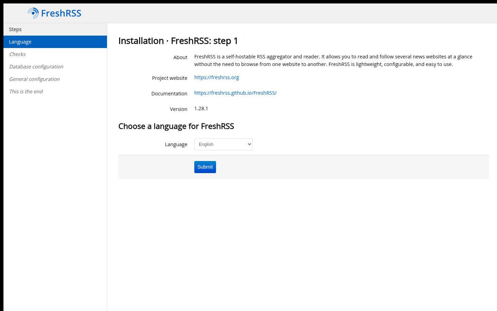

# Titan

Titan ist ein nichtkommerzielles Homeserver-Betriebssystem für Intel- und AMD-Rechner. Dateien, Fotos, Docker-Apps und virtuelle Maschinen lassen sich im Browser verwalten. Das System basiert auf umbrelOS 2.1. Das Titan-Projekt prüft Änderungen aus dem ursprünglichen Projekt und veröffentlicht eigene, signierte Systemupdates. [Ausgangsstand](https://github.com/getumbrel/umbrel/tree/27292d7044a912a8a845917b7698ad3dfdd2676d)

## Installation auf SSD oder NVMe

1. Sichere vorhandene Daten. **Das Schreiben des Images überschreibt die Partitionstabelle und den Inhalt des gewählten Laufwerks.**
2. Lade für einen x86-64-Rechner mit UEFI die Datei `titan-amd64.img.xz` und das zugehörige `manifest.txt` aus derselben Veröffentlichung. Vergleiche den SHA-256-Wert der komprimierten Datei mit dem Eintrag im Manifest.
3. Schließe die Ziel-SSD an einen anderen Rechner an. Entpacke das Image mit einem XZ-fähigen Werkzeug und schreibe die entstandene `.img` mit einem Programm für Datenträgerabbilder auf die **gesamte SSD**. Prüfe Modell und Größe des Ziels vor dem Schreiben.
4. Baue die SSD in den Server ein und starte den Rechner im UEFI-Modus. Secure Boot muss für dieses Image ausgeschaltet sein. Verbinde den Server per Ethernet mit dem Heimnetz. Öffne die vom Router zugewiesene IP-Adresse im Browser und lege das Eigentümerkonto an.

Für spätere Updates genügt die Systemaktualisierung in den Einstellungen. Titan prüft die Freigabesignatur und den Hash des für den Rechner vorgesehenen Bundles. Zusammengehörige Teile einer größeren Aktualisierung lädt Titan selbst. Erstelle vor einem Update eine aktuelle Sicherung wichtiger Dateien und VMs. [Veröffentlichungen](https://github.com/ra5on/Titan/releases)

## Apps und Fernzugriff

Die offiziellen Umbrel-Clients für Android und macOS behalten ihre bisherigen Updatewege. Titan verwendet die Anmelde- und Kopplungsschnittstellen der gemeinsamen Basis. Eine vollständige Kopplungsprüfung mit den veröffentlichten Clients auf beiden Plattformen steht aus.

Der integrierte App-Katalog enthält FreshRSS. Weitere kompatible Kataloge lassen sich als Community-Stores hinzufügen. Installierte Apps beziehen ihre Container-Images aus der Registry des jeweiligen Anbieters. Umbrel pflegt seinen eigenen Katalog und die dazugehörige Bildergalerie separat. [Umbrel-App-Pakete](https://github.com/getumbrel/umbrel-apps) · [Bildergalerie](https://github.com/getumbrel/umbrel-apps-gallery)

Als Eigentümer kannst du die Weboberfläche einer laufenden Docker-App im Titan-Desktop öffnen. Dafür startet auf dem Server ein temporärer Browser mit Zugang zu dieser App. Beim ersten Öffnen lädt Titan das Browser-Image aus seiner GitHub-Veröffentlichung und prüft die Prüfsumme. Die Sitzung läuft über dieselbe Webadresse wie der Desktop. Ein Reverse-Proxy oder Cloudflare-Tunnel muss HTTP und WebSocket-Verbindungen an Titan weiterleiten. Für diese Ansicht genügt ein einziges öffentliches Ziel. Mitgliedskonten und reine Tor-Apps verwenden den herkömmlichen App-Aufruf. Der eingeschränkte Browser eignet sich für webbasierte Bedienoberflächen. Eine Sitzung mit einem öffentlichen Cloudflare-Tunnel wurde bisher nicht separat getestet.

*FreshRSS beim ersten Start, aufgenommen über den lokalen WebSocket-Zugang des Titan-App-Browsers.*

## Virtuelle Maschinen

| Funktion | Verwendung und Voraussetzungen |
| --- | --- |
| Vorhandenes QCOW2-Abbild | Lege die eigenständige `.qcow2`-Datei in Titan ab und wähle sie beim Anlegen der VM aus. Ein komprimiertes Home-Assistant-OS-Abbild für KVM/OVA muss vorher entpackt werden. Der Import arbeitet mit einer Kopie. Images mit externen Daten- oder Basisdateien werden abgewiesen. |
| Ordner teilen | Wähle einen Ordner aus deinem persönlichen Home-Verzeichnis und vergib einen Freigabenamen. Der Gast braucht einen virtiofs-Treiber. In einem Linux-Gast lässt sich beispielsweise die Freigabe `medien` auf ein vorhandenes Verzeichnis mit `mount -t virtiofs medien /mnt/medien` einhängen. Freigaben sind standardmäßig schreibgeschützt. |
| USB-Geräte | Weise einen USB-Port der VM zu. Das ist unter anderem für Zigbee-Adapter und den Coral USB Accelerator vorgesehen. Der Coral-Stick wechselt beim Laden seiner Firmware die USB-Kennung. Die Zuordnung orientiert sich am physischen Anschluss. |
| iGPU, NVIDIA-/AMD-GPU, NPU | Der Host braucht KVM und eine aktive IOMMU. Das Gerät muss als unterstützte PCI-Funktion sichtbar und seine vollständige, geeignete IOMMU-Gruppe für `vfio-pci` vorbereitet sein. Ein direkt zugewiesenes Gerät steht dem Gast exklusiv zur Verfügung. Änderungen an der PCI-Zuordnung werden beim nächsten VM-Start wirksam. |

Home Assistant OS 18.4 wurde aus dem offiziellen QCOW2-Abbild importiert, sektorweise verglichen und mit QEMU und UEFI bis zum Login gestartet. Ein separater Linux-Gast las und schrieb Dateien auf einer virtiofs-Testfreigabe. Bei einer hostseitig schreibgeschützten Freigabe konnte derselbe Gast lesen und erhielt beim Schreibversuch einen Dateisystemfehler. Durchreichung und Treiberbetrieb eines konkreten Coral-Sticks, einer Grafikkarte oder einer integrierten NPU wurden bislang nicht an physischer Hardware bestätigt. [Home Assistant OS](https://github.com/home-assistant/operating-system/releases/tag/18.4) · [VFIO und IOMMU-Gruppen](https://docs.kernel.org/driver-api/vfio.html) · [Coral USB Accelerator](https://coral.ai/docs/accelerator/get-started/)

## KI und Netzwerkverbindungen

Suche, Texterkennung und Transkription verwenden lokale Modelle. Bei Bedarf bezieht Titan Modelldateien von ihren Originalquellen und prüft ihre SHA-256-Werte. Für die mit der Gesichtserkennung verwendeten InsightFace-Gewichte beschränkt der Anbieter die öffentliche Freigabe auf nichtkommerzielle Forschung. Diese Gewichte müssen mit den passenden Nutzungsrechten separat bereitgestellt werden. Für externe KI-Agenten steht die MCP-Anbindung der Basis zur Verfügung. [Modellquellen und Prüfsummen](packages/umbreld/source/modules/files/models.json) · [Nutzungsbedingungen von InsightFace](https://github.com/deepinsight/insightface#license)

| Funktion | Netzwerkziel |
| --- | --- |
| Systemupdates und Schlüssel | Titan-Repository und Titan-Releases auf GitHub. Der Updateabruf übermittelt weder Hardwarekennung noch installierte Version an den Updatekanal. |
| App-Katalog und Fotos | Der mitgelieferte Katalog und seine Oberfläche werden lokal ausgeliefert. Eine zusätzliche Foto-Kartenquelle kann der Betreiber über `TITAN_MAP_URL` einrichten. |
| App-Installation und Modelle | Die konfigurierte Container-Registry beziehungsweise die in der Modelldatei genannten Quellen, darunter Hugging Face, ModelScope und GitHub. |
| Cloud-Konten | Verbindungen gehen zum ausgewählten Dienst. Anbindungen über OAuth erfordern einen eigenen Callback-Dienst und eigene Client-Zugangsdaten. |
| Native Clients, Community-Stores, installierte Apps und Tunnel | Die jeweiligen Anbieter und die eigene Konfiguration bestimmen deren Netzwerkziele. Ein öffentlicher Tunnel stellt eine Verbindung zum gewählten Tunnelanbieter her. |

## Herkunft, Lizenzen und Weitergabe

Für den von Umbrel übernommenen Betriebssystemcode gilt die **PolyForm Noncommercial License 1.0.0**. Titan gibt seine Bearbeitungen dieses Codes zu denselben Bedingungen weiter. Die Lizenz erlaubt die Nutzung, Änderung und Weitergabe für die darin beschriebenen nichtkommerziellen Zwecke. Bei jeder Weitergabe von erfasstem Code oder eines fertigen Images müssen die Empfänger den Lizenztext oder dessen URL sowie alle vom Lizenzgeber mitgelieferten Zeilen erhalten, die mit `Required Notice:` beginnen. Der Originaltext ist in diesem Repository enthalten. [Lizenztext](LICENSE.md) · [Umbrels Lizenz-FAQ](https://github.com/getumbrel/umbrel/wiki/License-FAQ)

Für kommerzielle Angebote wie vorinstallierte Server, kostenpflichtiges Hosting oder bezahlten Support für den Fork verweist Umbrel auf eine gesonderte Vereinbarung. Ansprechpartner für die kommerzielle Nutzung des Umbrel-Codes ist `partner@umbrel.com`. [Lizenzangaben des ursprünglichen Projekts](https://github.com/getumbrel/umbrel/blob/27292d7044a912a8a845917b7698ad3dfdd2676d/README.md#license)

Für Drittsoftware, Container-Images, App-Pakete, Schriften, Logos und Screenshots gelten die Rechte der jeweiligen Urheber und Anbieter. Ein Eintrag im öffentlichen App-Katalog allein erteilt keine pauschale Erlaubnis zur Spiegelung. Die Datei `titan-paketquellen.tsv` im Release führt die installierten Debian- und Herstellerpakete mit ihren Versionen und Bezugsquellen für System und App-Browser auf. Zur modifizierten Avahi-Version gehören zusätzlich die Patches im Repository. Weitere Komponenten, Bezugsquellen und Buildschritte dokumentiert der Build der gemeinsamen Basis. Die Paketlizenzen liegen im jeweiligen Dateisystem unter `/usr/share/doc`. [Avahi-Patches](packages/os/avahi-patches) · [System-Build](packages/os/umbrelos.Dockerfile) · [App-Browser-Build](packages/os/viewer/Dockerfile)

Umbrel und umbrelOS bezeichnen das ursprüngliche Projekt und dessen Software. Für Fragen und Fehlerberichte zu Titan ist das Titan-Projekt zuständig. [Titan auf GitHub](https://github.com/ra5on/Titan)

## Gewährleistung, Haftung und Datensicherung

Titan wird unentgeltlich im jeweils vorliegenden Zustand bereitgestellt. Das Projekt übernimmt keine Garantie für Fehlerfreiheit, Verfügbarkeit, Kompatibilität mit bestimmter Hardware oder die Wiederherstellbarkeit von Daten. Soweit gesetzlich zulässig, ist die Haftung der Projektverantwortlichen und Mitwirkenden für Schäden aus Installation, Updates oder Betrieb ausgeschlossen. Dazu zählen insbesondere Datenverlust, beschädigte Dateisysteme, fehlgeschlagene Wiederherstellungen und Betriebsausfälle.

Zwingende gesetzliche Ansprüche bleiben bestehen. Der Ausschluss gilt insbesondere nicht bei Vorsatz oder grober Fahrlässigkeit, bei schuldhafter Verletzung von Leben, Körper oder Gesundheit oder soweit das jeweils anwendbare Produkthaftungsrecht eine Haftung vorschreibt. [§ 276 BGB](https://www.gesetze-im-internet.de/bgb/__276.html) · [§ 309 Nr. 7 BGB](https://www.gesetze-im-internet.de/bgb/__309.html)

**Das Schreiben eines Systemimages überschreibt das gewählte Laufwerk einschließlich seiner Partitionen und Daten.** Prüfe das Ziellaufwerk anhand von Modell und Größe. Sichere wichtige Dateien, Konfigurationen und VM-Daten vor Installation oder Updates auf einem getrennten Datenträger und prüfe, ob sich die Sicherung wiederherstellen lässt.
